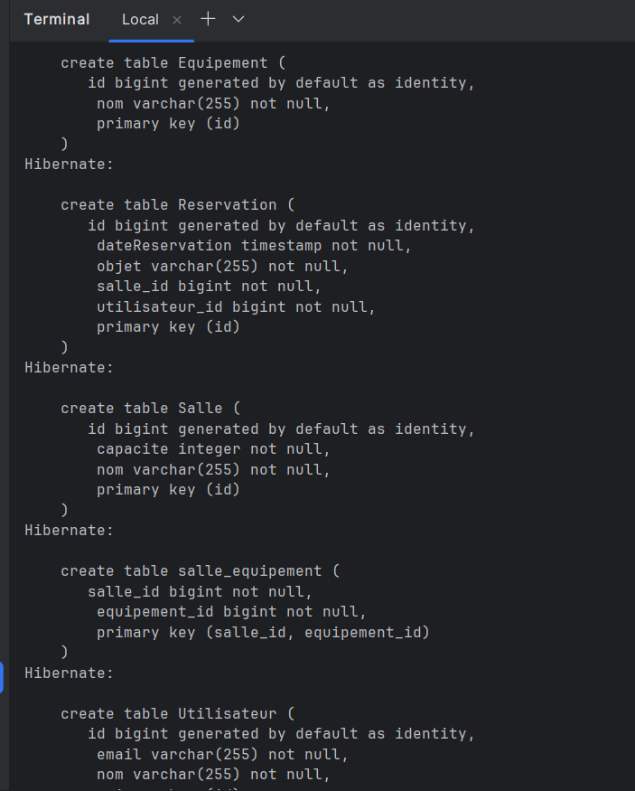
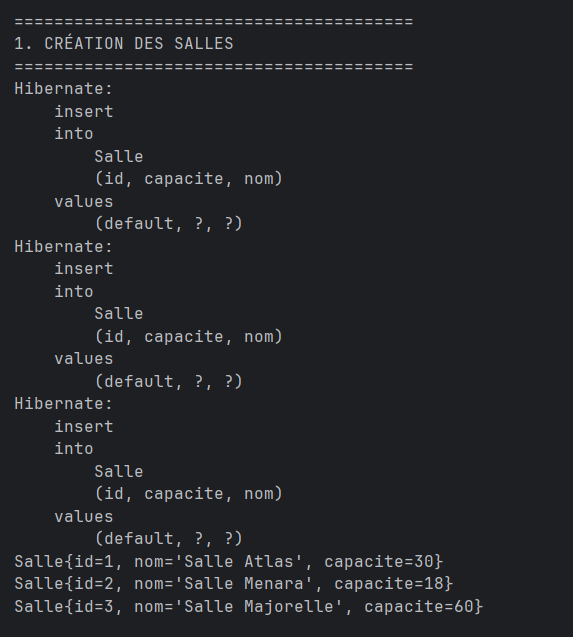
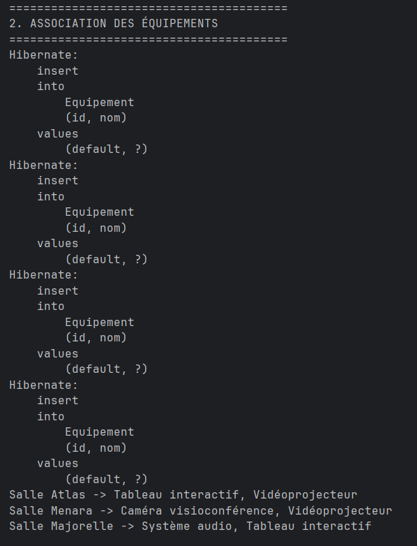
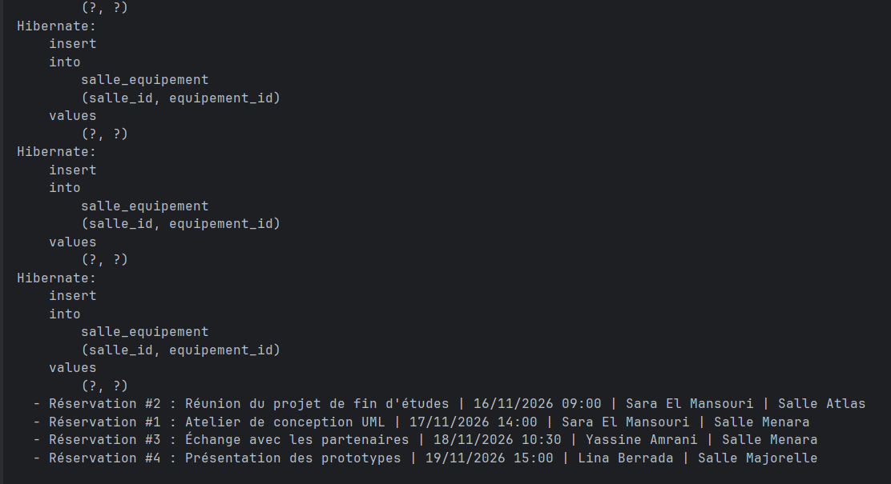
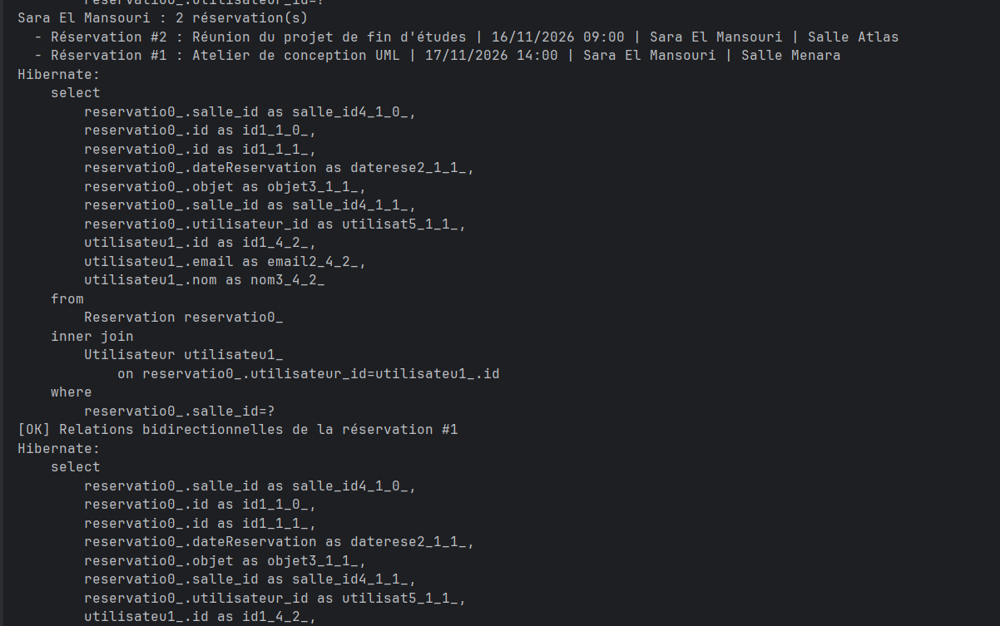
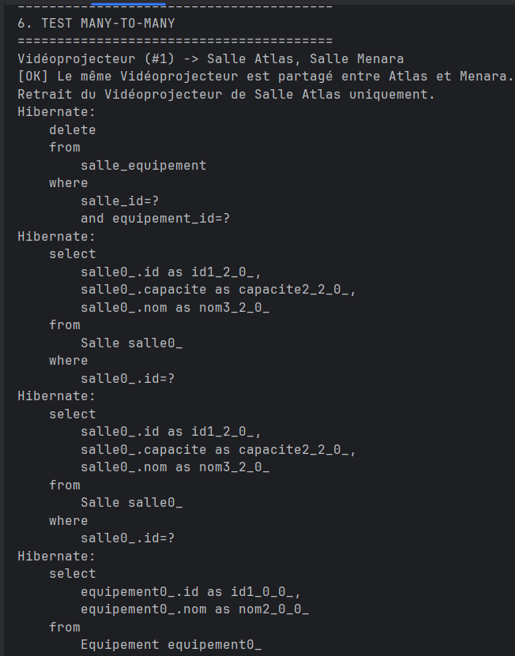
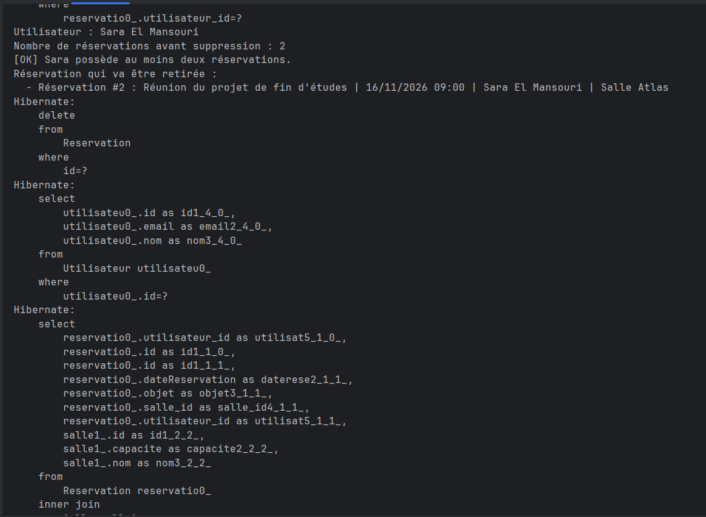
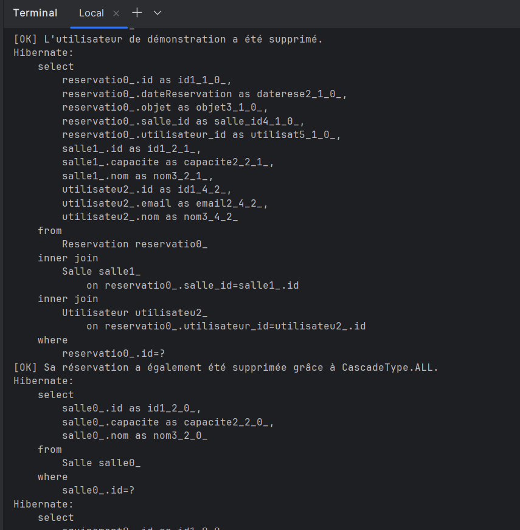
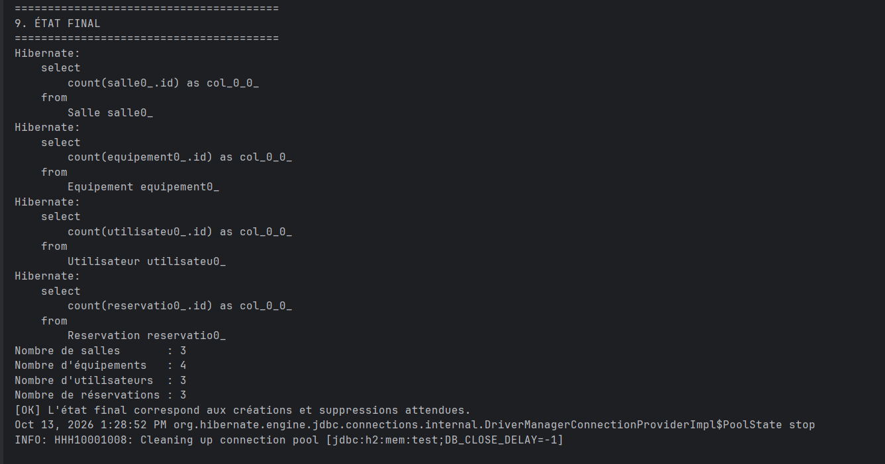

# TP - Gestion des réservations avec JPA et Hibernate

## Captures d'écran d'exécution

### 1. Création du schéma et des relations

Cette capture montre la création automatique des tables par Hibernate, notamment les tables `Salle`, `Utilisateur`, `Reservation`, `Equipement` ainsi que la table de jointure utilisée pour la relation entre les salles et les équipements.

### 2. Création des salles

Cette capture montre l'enregistrement des différentes salles dans la base H2 avec leurs capacités respectives.

### 3. Association des équipements

Cette partie montre l'ajout des équipements et leur association aux différentes salles. Un même équipement peut être utilisé par plusieurs salles.

### 4. Création des réservations

Cette capture montre les réservations créées pour les différents utilisateurs, avec la date, l'objet de la réservation et la salle concernée.

### 5. Vérification des relations bidirectionnelles

Cette capture permet de vérifier que les relations entre les utilisateurs, les réservations et les salles sont correctement maintenues dans les deux sens.

### 6. Test de la relation ManyToMany

Cette capture montre qu'un même vidéoprojecteur peut être partagé entre plusieurs salles. Après le retrait de l'association avec une salle, l'équipement reste présent dans la base et continue d'être associé à l'autre salle.

### 7. Test de la suppression orpheline

Cette capture montre le fonctionnement de `orphanRemoval`. Une réservation est retirée de l'utilisateur et Hibernate la supprime automatiquement de la base de données.

### 8. Suppression en cascade

Cette capture montre que la suppression d'un utilisateur entraîne également la suppression de sa réservation associée grâce à la cascade configurée entre les entités.

### 9. État final de l'application

Cette dernière capture affiche le nombre final de salles, équipements, utilisateurs et réservations après l'ensemble des opérations. Elle confirme que les créations, associations et suppressions ont été exécutées correctement.

